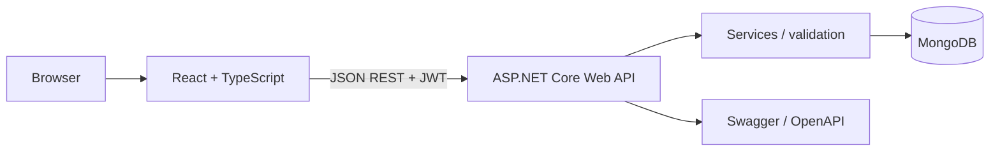

# NutriPlate – Nutrition & Meal Planning Platform

**Plan your meals, track your nutrition, and build healthier eating habits.**

NutriPlate is a full-stack learning/portfolio application using React + TypeScript + Vite, ASP.NET Core Web API (C#), and MongoDB. It includes recipe discovery, estimated nutrition, weekly planning, favorites, profile preferences, grocery lists, JWT authentication, API documentation, seed data, tests, and setup guides.

> **Nutrition notice:** nutrition figures are illustrative estimates for demo recipes, not medical advice or verified clinical data. Consult reliable food databases and a qualified professional for health decisions.

## Features

- Register and log in with hashed passwords and JWT bearer authentication.
- Browse, search, filter, and inspect recipes.
- Save favorites.
- Create meal plans and add/remove planned meals by day and meal type.
- Calculate estimated calories and macronutrients from planned recipes and serving counts.
- Generate grocery lists from selected planned meals, check off items, and add/remove items.
- Manage profile, dietary preferences, and food restrictions.
- Swagger/OpenAPI in Development, centralized exception handling, validation, MongoDB indexes, and seed data.
- Responsive UI, loading/error/empty states, accessible form labels, and frontend tests.

## Technology versions

- .NET 10 (LTS target framework; install a .NET 10 SDK compatible with your platform)
- React 19, TypeScript 5, Vite 7
- MongoDB.Driver 3.x
- xUnit test project
- Vitest + React Testing Library

Package versions are pinned in project manifests. Package restore may select compatible transitive patches.

## Screenshots

Add real screenshots here after running the app. Suggested shots: Dashboard, Recipe discovery with filters, Recipe details, Weekly planner, Grocery list, Profile/preferences, and mobile layout.

## Architecture



## Prerequisites

- Windows 10/11, macOS, or Linux
- .NET 10 SDK
- Node.js 22+ and npm
- MongoDB Community Server running locally, or a MongoDB Atlas cluster
- Git (optional)

## Quick start (Windows PowerShell)

1. Start MongoDB locally, or create an Atlas database user and allow your IP in Network Access.
2. In a terminal at the project root:

```powershell
Copy-Item .env.example .env
```

3. Set the backend environment variables in the current PowerShell session (replace the JWT key with a private random value):

```powershell
$env:MongoDb__ConnectionString="mongodb://127.0.0.1:27017"
$env:MongoDb__DatabaseName="NutriPlate"
$env:Jwt__Key="replace-with-a-private-random-secret-at-least-32-characters"
$env:Jwt__Issuer="NutriPlate.Api"
$env:Jwt__Audience="NutriPlate.Client"
$env:Frontend__Origin="http://localhost:5173"
```

4. Start the API:

```powershell
cd backend/NutriPlate.Api
dotnet restore
dotnet run --urls http://localhost:5080
```

5. In a second terminal, from the project root:

```powershell
cd frontend
Copy-Item .env.example .env
npm install
npm run dev
```

Open `http://localhost:5173`. Swagger is available at `http://localhost:5080/swagger` in Development.

### Configuration

Backend configuration uses standard ASP.NET Core environment variables:
- `MongoDb__ConnectionString`
- `MongoDb__DatabaseName`
- `Jwt__Key` (private, at least 32 characters)
- `Jwt__Issuer`
- `Jwt__Audience`
- `Frontend__Origin`

Frontend `.env`:
- `VITE_API_BASE_URL` (default `http://localhost:5080/api`)

Never commit real `.env` files, database passwords, JWT keys, or production secrets.

## Seed data

The API seeds demo recipes and creates indexes on startup. The operation is idempotent by recipe ID. Seeded nutrition is illustrative. User registration is required for user-specific features; there is no hard-coded demo login.

## Tests

Frontend:

```powershell
cd frontend
npm install
npm test
npm run build
```

Backend:

```powershell
cd backend
dotnet restore
dotnet test
```

The current archive generation environment did not execute these commands; see `docs/TEST_PLAN.md` for honest verification status.

## Troubleshooting

- **MongoDB connection refused:** confirm the service/Atlas cluster is running and the URI is correct.
- **Atlas authentication failed:** use the database user's username/password (not the Atlas website login); URL-encode special characters in the password.
- **CORS error:** set `Frontend__Origin` to the exact frontend origin.
- **401 Unauthorized:** log in again and ensure the API base URL is correct.
- **Port in use:** change the port in `dotnet run --urls` and update `VITE_API_BASE_URL`.
- **Missing SDK:** run `dotnet --info` and install the .NET 10 SDK.

## Limitations and future improvements

This is a portfolio starter, not a production-certified health or nutrition product. Before production, add refresh-token rotation, rate limiting, email verification/password reset, richer audit/security monitoring, deployment secrets management, and a verified nutrition data provider. Grocery aggregation deliberately combines only exact ingredient names and units; it does not convert between units.

## Documentation

See `docs/` for the project report, architecture, database schema, API reference, installation, user, test, requirements, deployment, and portfolio summary.
